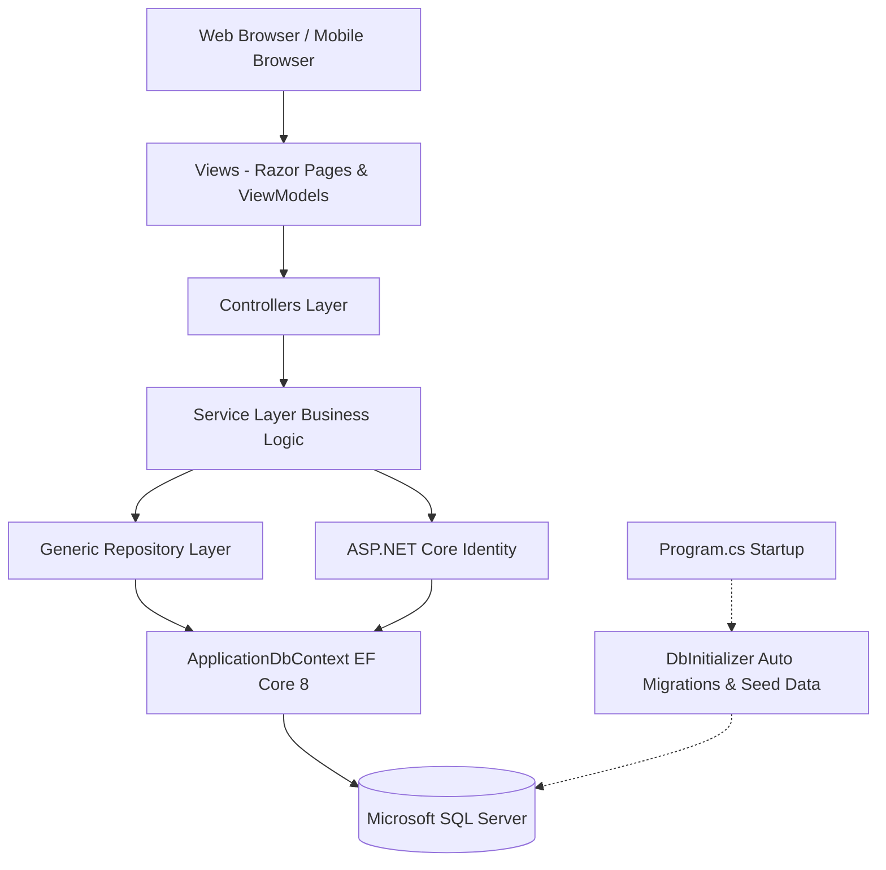

# 🩸 LifeSaver - Blood Bank Management System

[](https://dotnet.microsoft.com/)
[](https://learn.microsoft.com/aspnet/core/mvc)
[](https://learn.microsoft.com/ef/core/)
[](https://www.microsoft.com/sql-server)
[](https://getbootstrap.com/)
[](LICENSE)

**LifeSaver** is an enterprise-grade, full-stack **Blood Bank Management System** built with **ASP.NET Core 8.0 (MVC)** and **Entity Framework Core**. It streamlines blood donor registration, manages emergency blood requests from recipients and hospitals, tracks real-time inventory across all eight blood groups, and handles appointment scheduling with full role-based access control (RBAC).

---

## 📑 Table of Contents

- [Overview & Key Features](#-overview--key-features)
- [User Roles & Permissions](#-user-roles--permissions)
- [System Architecture](#-system-architecture)
- [Tech Stack](#-tech-stack)
- [Project Structure](#-project-structure)
- [Database Schema & Models](#-database-schema--models)
- [Getting Started](#-getting-started)
  - [Prerequisites](#prerequisites)
  - [Configuration](#configuration)
  - [Running the Application](#running-the-application)
- [Default Seed Credentials](#-default-seed-credentials)
- [Core Workflows](#-core-workflows)
- [Deployment](#-deployment)
- [Contributing & License](#-contributing--license)

---

## 🌟 Overview & Key Features

### 1. 🩸 Real-Time Blood Inventory Management
- Live tracking of blood units for all 8 blood groups: `A+`, `A-`, `B+`, `B-`, `AB+`, `AB-`, `O+`, `O-`.
- Automatic stock increment upon completed blood donation verification.
- Automatic stock deduction upon approval and dispatch of blood requests.
- Low-stock visual alerts and detailed stock audit trails.

### 2. 👥 Multi-Role User Portal
- Dedicated portals and tailored dashboard navigation for **Admins**, **Donors**, **Recipients**, and **Hospitals**.
- Seamless onboarding with role-specific profile initialization upon registration.
- Dynamic navigation bar adapting automatically to the authenticated user's role.

### 3. 📅 Appointment Scheduling & Donation Tracking
- Donors can schedule donation appointments online with preferred dates, times, and medical notes.
- Admins review, approve, reject, or complete donor appointments.
- Complete donation history ledger linking donor records, units donated, and donation dates.

### 4. 🏥 Emergency Blood Request & Dispatch System
- Recipients and healthcare institutions (hospitals) can submit emergency blood requests specifying units and patient details.
- Multi-state request lifecycle: `Pending` ➔ `Approved` / `Rejected` ➔ `Completed`.
- Real-time stock validation preventing over-allocation of blood inventory.

### 5. 🎨 Modern Glassmorphic Dark UI
- High-contrast, dark-mode design with frosted-glass backdrop blur effects (`backdrop-filter: blur(16px)`).
- Responsive layouts built on Bootstrap 5 and FontAwesome 6 icons.
- Micro-animations, alert badges, and KPI statistic cards.

### 6. 🛡️ Enterprise Security & Logging
- ASP.NET Core Identity with hashed credentials and account lockout protection against brute-force attacks.
- CSRF protection enabled via `[ValidateAntiForgeryToken]` across all forms.
- Structured centralized logging via **Serilog** with console output and diagnostic enrichment.

---

## 🔐 User Roles & Permissions

| Role | Access Scope & Capabilities |
| :--- | :--- |
| **Admin** | Full system administration: View aggregate KPIs, manage donor/recipient/hospital directories, update inventory stock, approve/reject appointments, process blood requests, and review donation logs. |
| **Donor** | Manage donor profile, schedule donation appointments, view personal appointment statuses, view donation history, and check blood stock availability. |
| **Recipient** | Manage recipient profile, check live blood stock, submit blood requests for self or family members, and track request fulfillment status. |
| **Hospital** | Institutional profile management, check inventory reserves, submit patient blood requests in bulk, and review request history. |

---

## 🏗️ System Architecture

LifeSaver adopts a clean, layered architectural pattern adhering to SOLID principles and separation of concerns:



### Architectural Highlights:
- **Separation of Concerns**: Controllers delegate domain operations to dedicated Services (`IDonorService`, `IBloodRequestService`, etc.).
- **Generic Repository Pattern**: Encapsulates common CRUD operations (`IGenericRepository<T>`).
- **Strongly-Typed ViewModels**: Ensures data validation with DataAnnotations and FluentValidation before reaching domain models.
- **Auto-Initialization**: Automatic EF Core database migration and role/seed data injection on startup.

---

## 💻 Tech Stack

- **Framework**: [.NET 8.0 SDK](https://dotnet.microsoft.com/download/dotnet/8.0)
- **Application Type**: ASP.NET Core MVC (Model-View-Controller)
- **Data Access**: Entity Framework Core 8.0 (Code-First)
- **Database**: Microsoft SQL Server / LocalDB
- **Authentication**: ASP.NET Core Identity with role-based authorization
- **Validation**: FluentValidation 11.3 + System.ComponentModel.DataAnnotations
- **Logging**: Serilog 8.0 (Console + Configuration Sink)
- **Front-End**: Razor Views, HTML5, Vanilla CSS3 (Glassmorphism), Bootstrap 5.3, FontAwesome 6.4, jQuery

---

## 📁 Project Structure

```text
BloodBankManagement/
├── Controllers/                 # MVC Controllers handling HTTP requests
│   ├── AccountController.cs         # Authentication, registration, logout, lockout
│   ├── AppointmentController.cs     # Donor appointment booking and status workflows
│   ├── BloodDonationController.cs   # Donation recording and inventory linking
│   ├── BloodInventoryController.cs  # Stock tracking and manual adjustments
│   ├── BloodRequestController.cs    # Emergency blood requests and approval lifecycle
│   ├── DonorController.cs           # Donor profiles and administration
│   ├── HomeController.cs            # Admin KPI dashboard, landing page, error handlers
│   ├── HospitalController.cs        # Hospital records and institutional profiles
│   ├── RecipientController.cs       # Recipient profiles and management
│   └── UserTypeController.cs        # Role onboarding and profile type selection
├── Data/                        # Data access and database initialization
│   ├── ApplicationDbContext.cs      # EF Core DbContext with relationship configurations
│   └── DbInitializer.cs             # Migration execution, role & admin seeding, inventory stock
├── Models/                      # Domain entities and enums
│   ├── ApplicationUser.cs           # Custom Identity user entity
│   ├── Appointment.cs               # Donor appointment entity
│   ├── BloodDonation.cs             # Completed blood donation log
│   ├── BloodInventory.cs            # Stock entity per blood group
│   ├── BloodRequest.cs              # Blood requisition entity
│   ├── Donor.cs                     # Registered donor entity
│   ├── Hospital.cs                  # Registered hospital entity
│   ├── Recipient.cs                 # Registered recipient entity
│   ├── Roles.cs                     # Role constants and policy groups
│   └── Enums.cs                     # Domain enumerations (BloodType, etc.)
├── Repositories/                # Generic repository implementation
│   ├── IGenericRepository.cs        # Generic repository contract
│   └── GenericRepository.cs         # EF Core repository implementation
├── Services/                    # Domain service interfaces and implementations
│   ├── IAppointmentService.cs & AppointmentService.cs
│   ├── IBloodDonationService.cs & BloodDonationService.cs
│   ├── IBloodInventoryService.cs & BloodInventoryService.cs
│   ├── IBloodRequestService.cs & BloodRequestService.cs
│   ├── IDonorService.cs & DonorService.cs
│   ├── IHospitalService.cs & HospitalService.cs
│   └── IRecipientService.cs & RecipientService.cs
├── ViewModels/                  # Strongly-typed presentation models
│   ├── AccountViewModels.cs         # Login, Register, Profile ViewModels
│   ├── EntityViewModels.cs          # Donor, Recipient, Hospital, Inventory ViewModels
│   └── ExpansionViewModels.cs       # Request, Appointment, Donation, AdminDashboard ViewModels
├── Views/                       # Razor views organized by feature
│   ├── Account/                     # Login, Register, AccessDenied
│   ├── Appointment/                 # Appointment booking, list, approval views
│   ├── BloodDonation/               # Donation records and logging
│   ├── BloodInventory/              # Stock tables and visual indicators
│   ├── BloodRequest/                # Requisition creation and management
│   ├── Donor/                       # Donor profiles and directory
│   ├── Home/                        # Landing page and Admin dashboard
│   ├── Hospital/                    # Hospital directory and profile
│   ├── Recipient/                   # Recipient directory and profile
│   └── Shared/                      # _Layout.cshtml, _LoginPartial.cshtml, error pages
├── wwwroot/                     # Static assets
│   ├── css/site.css                 # Custom glassmorphism styling
│   ├── images/                      # Visual assets and medical graphics
│   └── js/site.js                   # Client-side scripts
├── appsettings.json             # Production application configuration & connection strings
├── appsettings.Development.json # Development configuration (LocalDB)
├── Program.cs                   # Application entry point, DI container, and middleware pipeline
└── BloodBankManagement.csproj   # Project file and NuGet package references
```

---

## 🗄️ Database Schema & Models

### Core Entities:
- **`ApplicationUser`**: Extends `IdentityUser` with `FirstName`, `LastName`, `IsActive`, and timestamps.
- **`Donor`**: Stores blood group, date of birth, contact information, last donation date, and foreign key to `ApplicationUser`.
- **`Recipient`**: Tracks patient details, blood group, contact information, and linked user account.
- **`Hospital`**: Institutional medical center details, contact numbers, and linked user account.
- **`BloodInventory`**: Tracks units in stock per blood group (`BloodGroup`, `Units`, `LastUpdated`).
- **`BloodRequest`**: Manages requisition requests (`BloodGroup`, `UnitsRequested`, `Status`, `PatientName`, `Remarks`).
- **`Appointment`**: Schedules donor visits (`AppointmentDate`, `Status`, `Notes`).
- **`BloodDonation`**: Audits confirmed donations (`UnitsDonated`, `DonationDate`, `BloodGroup`).

---

## 🚀 Getting Started

### Prerequisites

- [.NET 8.0 SDK](https://dotnet.microsoft.com/download/dotnet/8.0) or later
- [SQL Server](https://www.microsoft.com/sql-server) (LocalDB, Express, or Full Server)
- [Visual Studio 2022](https://visualstudio.microsoft.com/) (v17.8+) or [Visual Studio Code](https://code.visualstudio.com/) with C# Dev Kit

### Configuration

Check connection strings in `appsettings.json` or `appsettings.Development.json`:

```json
{
  "ConnectionStrings": {
    "DefaultConnection": "Server=(localdb)\\MSSQLLocalDB;Database=BloodBankManagementDb;Trusted_Connection=True;MultipleActiveResultSets=True;Encrypt=False;"
  }
}
```

> **Note**: The application automatically checks for pending migrations and applies them on startup via `DbInitializer.InitializeAsync()`. If the database does not exist, it will automatically create and seed it.

### Running the Application

#### Option 1: Via .NET CLI

1. Open your terminal in the project directory:
   ```bash
   cd "BloodBankManagement"
   ```

2. Restore NuGet dependencies:
   ```bash
   dotnet restore
   ```

3. Build the project:
   ```bash
   dotnet build
   ```

4. Run the web application:
   ```bash
   dotnet run
   ```

5. Open your browser and navigate to:
   ```text
   https://localhost:5001 or http://localhost:5000
   ```

#### Option 2: Via Visual Studio 2022

1. Open `BloodBankManagement.slnx` or `BloodBankManagement.csproj` in Visual Studio.
2. Select `https` or `IIS Express` from the run target dropdown.
3. Press `F5` to build and run with debugging.

---

## 🔑 Default Seed Credentials

Upon initial launch, `DbInitializer` automatically provisions the system administrator account and sample lookup data:

| Attribute | Default Value |
| :--- | :--- |
| **Email / Username** | `admin@bloodbank.local` |
| **Password** | `Admin@123` |
| **Assigned Role** | `Admin` |

### Pre-Seeded Reference Data:
- **All 8 Blood Groups** with initial baseline inventory stocks.
- **Sample Partner Hospitals**:
  - *City General Hospital*
  - *St. Jude Children Hospital*
  - *Red Cross Medical Center*

---

## 🔄 Core Workflows

### 1. Donor Donation Lifecycle
```text
Donor Registers / Logs In 
  ➔ Submits "Book Appointment" (Selects Date & Notes)
  ➔ Status: Pending
  ➔ Admin Reviews & Approves Appointment
  ➔ Donor Donates Blood at Bank
  ➔ Admin Confirms Donation in "Blood Donations"
  ➔ System Auto-Increments Units in BloodInventory for Donor's Blood Group
```

### 2. Blood Requisition & Fulfillment Lifecycle
```text
Recipient or Hospital Submits "Blood Request"
  ➔ Specifies Blood Group, Units, & Patient Details
  ➔ Status: Pending
  ➔ Admin Reviews Request against Live Inventory
  ➔ If Stock Available ➔ Admin Approves Request
  ➔ System Auto-Deducts Units from BloodInventory
  ➔ Status: Approved / Completed
```

---

## 🌐 Deployment

The application includes production configuration files and supports multiple hosting environments:
- **IIS / Windows Server**: Ready with configured `web.config`.
- **Cloud / ASP.NET Web Hosting**: Pre-configured publish profiles (e.g. `runasp.net` web deployment).
- **Docker / Linux Containers**: Fully portable to Linux containers via standard ASP.NET Core .NET 8 runtime images.

To publish a self-contained or framework-dependent release bundle:
```bash
dotnet publish -c Release -o ./publish
```

---

## 📄 License

This project is open-source software licensed under the [MIT License](LICENSE).
